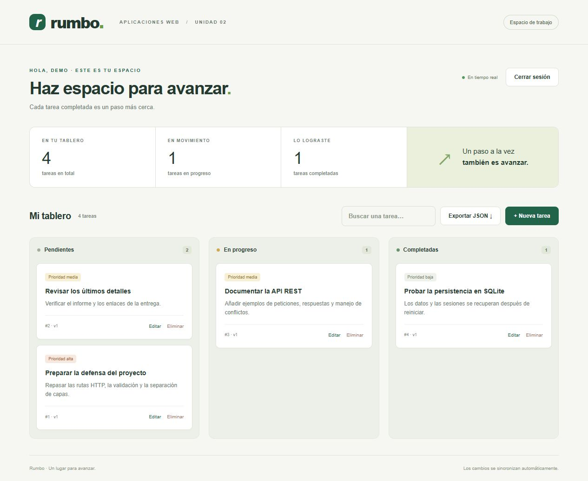

# Rumbo · API REST de tareas

**Aplicaciones Web · Unidad 2 · Programación del lado del servidor**  
Universidad Politécnica Salesiana · Bianchi Navarro

Este proyecto corresponde a la tarea de la Unidad 2 de Aplicaciones Web. Consiste en una API para organizar tareas personales, desarrollada con Node.js y Express. Los datos se guardan en SQLite y cada usuario puede acceder a sus tareas desde un tablero web.

La aplicación permite crear, consultar, editar y eliminar tareas. También incluye inicio de sesión, exportación a JSON y avisos en tiempo real para que los cambios aparezcan en las demás pestañas abiertas.



## Archivos del trabajo

- [Repositorio](https://github.com/bianchi-navarro/tareas-api-aplicaciones-web-u2)
- [Informe técnico de dos páginas](docs/Navarro_Bianchi_AplWeb_U2.pdf)
- [Pasos para demostrar la aplicación y evidencias](docs/DEMOSTRACION.md)
- [Documentación de la API y ejemplos](docs/API.md)
- [Colección Postman](docs/Tareas_U2.postman_collection.json)
- [Resultados de las pruebas en GitHub Actions](https://github.com/bianchi-navarro/tareas-api-aplicaciones-web-u2/actions)

La demostración se ejecuta de forma local en `http://127.0.0.1:3000`. En este repositorio se encuentran el código, el informe, las capturas y los resultados de las pruebas.

## Cómo ejecutar el proyecto

Se necesita Git y **Node.js 22.20.0**, o una versión posterior de la rama 22. Se utilizó esta versión porque incluye el módulo `node:sqlite`. Al ejecutarlo puede aparecer un aviso de que el módulo todavía es experimental.

Para descargar el proyecto e iniciar la demostración:

```sh
git clone https://github.com/bianchi-navarro/tareas-api-aplicaciones-web-u2.git
cd tareas-api-aplicaciones-web-u2
npm ci
npm run demo
```

Después se abre **http://127.0.0.1:3000** en el navegador. La cuenta de prueba es **demo** y su contraseña es **RumboDemo2026!**. Este modo funciona solo en la computadora donde se ejecuta y carga cuatro tareas de ejemplo en `data/demo.sqlite`. Los cambios se guardan al cerrar la aplicación; las tareas de ejemplo se vuelven a cargar únicamente si el tablero queda vacío.

También se puede ejecutar `npm start` para comenzar sin datos de ejemplo y registrar una cuenta desde la pantalla de acceso. En ese caso, la base de datos se crea en `data/tareas.sqlite`.

Para que la sesión siga siendo válida después de reiniciar el servidor, hay que copiar `.env.example` a `.env` y configurar un `SESSION_SECRET` aleatorio de al menos 32 caracteres. Ese valor debe mantenerse entre ejecuciones. Si no se configura, la aplicación genera uno temporal y será necesario volver a iniciar sesión después de cada reinicio.

## Pruebas

```sh
npm test
npm run test:coverage
```

Se realizaron **27 pruebas automatizadas**. Estas revisan las operaciones CRUD, los datos inválidos, los títulos duplicados, las sesiones, la exportación y los eventos en tiempo real. También comprueban que un usuario no pueda consultar las tareas de otro y que los datos se conserven después de cerrar y abrir la base de datos.

Las pruebas usan solicitudes HTTP y bases de datos separadas, por lo que no modifican las tareas guardadas en la aplicación. El segundo comando muestra la cobertura del código del servidor; la revisión de la interfaz se hizo aparte en el navegador.

Para revisar las rutas en Postman, se puede importar la colección y ejecutarla en orden con Collection Runner. La colección maneja las cookies y los tokens necesarios. Se verificó con Newman y se obtuvieron **24 solicitudes y 41 comprobaciones aprobadas**. El resultado está en `docs/evidencias/postman.json`. Las pruebas del flujo SSE y del reinicio del servidor están en los archivos de pruebas de Node.js.

## Organización del código

El código está separado para que las rutas, las reglas de validación y las consultas a la base de datos se puedan revisar por partes.

```text
src/
  domain/           Esquemas Zod, errores y transformaciones puras
  http/             Rutas, controles de acceso y errores HTTP
  services/         Autenticación y coordinación de operaciones
  infrastructure/   SQLite, repositorios, almacén de sesiones y SSE
  app.js            Configuración de la aplicación y de las pruebas
  server.js         Inicio del servidor
public/             Interfaz HTML, CSS y JavaScript sin compilación
scripts/demo.js     Demostración local con datos iniciales
test/               Pruebas HTTP, persistencia, SSE y funciones puras
docs/               Informe, documentación, colección y evidencias
```

### Funcionamiento de la aplicación

- **Base de datos:** se eligió SQLite para guardar la información sin instalar un servidor de base de datos aparte. Las tablas usan `STRICT`, claves foráneas, restricciones `CHECK` e índices. Las consultas se preparan con parámetros y cada usuario tiene sus propias tareas.
- **Operaciones CRUD:** se usan `POST/GET /api/tasks` y `GET/PUT/PATCH/DELETE /api/tasks/:id`. `PUT` reemplaza los cuatro campos editables y `PATCH` modifica solo los enviados. Si se envía un campo que no corresponde, la API lo rechaza.
- **Ediciones simultáneas:** cada tarea tiene una versión que se devuelve en `ETag`, por ejemplo `"1"`. Para editarla o eliminarla se debe enviar esa versión en `If-Match`. Si dos pestañas intentan modificar la misma versión, solo se acepta el primer cambio. La API responde `428` si falta la versión, `412` si ya cambió y `409` si el título está duplicado. La versión se comprueba dentro de la misma consulta SQL que actualiza el registro.
- **Sesiones:** se guardan en SQLite y duran una hora. La cookie usa `HttpOnly` y `SameSite=Strict`; su identificador cambia al iniciar sesión y se invalida al salir. Las operaciones de escritura requieren un token CSRF. Las contraseñas se guardan con `scrypt` y una sal aleatoria, y se comparan en tiempo constante. También se limitan los intentos de autenticación a 30 por IP cada 15 minutos.
- **Cambios en tiempo real:** `GET /api/events` mantiene una conexión SSE. Cuando se guarda un cambio, se envía el evento `task.changed` al usuario correspondiente. Cada 15 segundos se comprueba que la sesión siga vigente y, al cerrar sesión, se termina la conexión. Como los eventos no se guardan, el tablero vuelve a consultar las tareas cuando se reconecta.
- **Exportación:** `GET /api/tasks/export` permite descargar todas las tareas del usuario en un archivo JSON.
- **Interfaz:** el tablero incluye búsqueda, formularios con etiquetas y confirmación antes de eliminar. El diseño se adapta al tamaño de la pantalla. Los datos se muestran con `textContent` y las cookies de sesión no se guardan en `localStorage`.

## Modelo de datos

`users(id, username UNIQUE, password_hash, created_at)`  
`tasks(id, owner_id FK, title, title_key, description, status, priority, version, created_at, updated_at)`  
`sessions(sid PK, data, expires_at)`

La restricción `UNIQUE(owner_id, title_key)` evita que un usuario tenga dos tareas con el mismo título normalizado. Los estados disponibles son `pendiente`, `en_progreso` y `completada`; las prioridades son `baja`, `media` y `alta`. Las respuestas de las tareas no incluyen contraseñas ni identificadores de sesión.

## Configuración

| Variable | Valor por defecto | Uso |
|---|---|---|
| `PORT` | `3000` | Puerto HTTP |
| `HOST` | `127.0.0.1` | Interfaz de escucha |
| `DB_PATH` | `./data/tareas.sqlite` | Persistencia |
| `SESSION_SECRET` | Aleatorio en desarrollo | Firma de cookies; usar uno estable y privado |
| `NODE_ENV` | Desarrollo | `production` exige secreto y activa cookie Secure |
| `TRUST_PROXY` | Desactivado | `1` únicamente detrás de un proxy HTTPS de confianza |

## Limitaciones

La aplicación está preparada para ejecutarse en un solo proceso. Las tareas y las sesiones se conservan en SQLite, pero las conexiones SSE y el contador de intentos de acceso se manejan en memoria. Si se ejecutaran varias instancias, sería necesario compartir esos dos mecanismos.

Para publicarla en un servidor haría falta configurar HTTPS, almacenamiento permanente, copias de seguridad y el proxy. SQLite y `scrypt` se usan de forma síncrona porque simplifican este proyecto; con muchos usuarios al mismo tiempo habría que revisar su efecto en el rendimiento. No se incluyeron recuperación de contraseña, verificación de correo ni roles de administrador.

## Relación con los requisitos de la tarea

| Criterio | Implementación y evidencia |
|---|---|
| HTTP y lógica funcional | Rutas coherentes, códigos, `Location`, `ETag`, funciones puras y capas; pruebas 01, 07, 10, 15, 25-27 |
| Persistencia y validación | SQLite, Zod, consultas preparadas, restricciones, conflictos; pruebas 08-13, 20 |
| Archivos, sesiones y tiempo real | Almacén SQLite, CSRF, exportación JSON y SSE por usuario; pruebas 02-06, 16-19, 21-22 |
| Pruebas, documentación y calidad | 27 pruebas, lockfile, CI, Postman, ejemplos, informe y demostración reproducible |

## Referencias

- Express.js. (s. f.). *5.x API reference*. https://expressjs.com/en/5x/api/
- Express.js. (s. f.). *Session middleware*. https://expressjs.com/en/resources/middleware/session/
- Node.js. (s. f.). *SQLite: Node.js v22.20.0 documentation*. https://nodejs.org/download/release/v22.20.0/docs/api/sqlite.html

